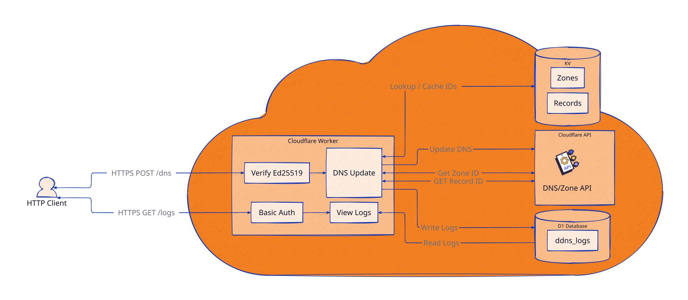

# Cloudflare Worker DDNS (Ed25519 Signed)

這是一個基於 Cloudflare Worker 建置 DDNS 服務，使用時透過 Ed25519 金鑰對請求進行簽章驗證，確保 DNS Record 更新的安全與可靠性。
使用 D1 Database 作為持久化的日誌系統，便於觀察與追蹤問題。

---
## Architecture


以下的 ID 可以透過 npx wrangler command 生成，但這個 ID 好像只是在 local 生成資料的資料夾的依據
Command example:
```bash
npx wrangler kv namespace create records
npx wrangler d1 namespace create zones
npx wrangler d1 create ddns
```
---
## 🛠️ 前置作業
### 0. Prepare wrangler.toml

```toml
name = "ddns"
main = "build/index.js"
compatibility_date = "2026-10-27"

[build]
command = "cargo install -q \"worker-build@^0.8\" && worker-build --release"

[[routes]]
pattern = "<worker's dns record>"
zone_name = "<base doamin of dns record>"
custom_domain = true

[[kv_namespaces]]
binding = "records"
id = "d40fd1c8cf8f492a851f284a769db0bf"

[[kv_namespaces]]
binding = "zones"
id = "13d2e99b9bd740838856e81de172cbea"

[[d1_databases]]
binding = "ddns"
database_name = "ddns"
database_id = "666616a3-38c8-4af4-bb0d-c59ccb3db060"
```
### 1. 生成 Ed25519 金鑰對
使用 OpenSSL 生成用於請求簽章的非對稱金鑰對（私鑰用於發送端簽章，公鑰用於 Worker 端驗證）：
```bash
openssl genpkey -algorithm Ed25519 -out private.pem
openssl pkey -in private.pem -pubout -out public.pem
```

### 2. 獲取 Cloudflare API 權限
* 需要至 Cloudflare Dashboard 設定頁面，建立並儲存一個具備 **DNS 編輯權限 (DNS Edit Access)** 的 API Token。

### 3. 生成 Basic 驗證資訊
有些 Worker page 使用 Basic 驗證保護，需要提供一組帳號密碼給 Worker 用來驗證。
```bash
echo -n jack:1256 | sha256
4f828794df6f100720347c020491547a98943c8bfd818d47701c5bd3c0a47bbf
```

---

## 💻 本地開發環境 (Local Development)

### 1. 環境變數配置
在 Cargo 專案根目錄下建立 `.dev.vars` 檔案，用以模擬線上 Worker 環境使用的 Cloudflare Secret：
```ini
CLOUDFLARE_API_TOKEN="xxxxxxxxxxx"
BASIC_AUTH_HASH=4f828794df6f100720347c020491547a98943c8bfd818d47701c5bd3c0a47bbf
PEM_TEXT="-----BEGIN PUBLIC KEY-----
MCowBQYDK2V.....
-----END PUBLIC KEY-----"
```

### 2. 本地資料庫遷移
執行資料庫遷移指令，在本地初始化 D1 Database 實例：
```bash
npx wrangler d1 migrations apply ddns --local
```

### 3. 啟動本機開發伺服器
啟動 Wrangler 進行本地模擬與除錯：
```bash
npx wrangler dev
```

---

## 🚀 線上環境部署 (Production Environment)

### 1. 配置 Worker 憑據與機密變數 (Secrets)
將加密金鑰與 API Token 安全地寫入 Cloudflare Worker 線上環境：
```bash
npx wrangler secret put CLOUDFLARE_API_TOKEN // cloudflare dashboard setting 拿有 DNS 權限的 API Token
npx wrangler secret put PEM_TEXT // public.pem
```

### 2. 生產環境資料庫遷移
將 D1 Database 的結構遷移套用至 Cloudflare 線上正式資料庫：
```bash
npx wrangler d1 migrations apply ddns --remote
```

### 3. 部署至 Cloudflare Workers
將應用程式編譯並發布至雲端環境：
```bash
npx wrangler deploy
```

---

## 📡 服務測試與請求觸發 (Client Verification)

### 1. 建構請求主體與 Ed25519 簽章
部署完成後，在用戶端（例如 NAS 或路由器）準備 Payload 內容，並使用私鑰進行 SHA-256 簽章：
```bash
printf '%s' '{"zone":"example123.com","record":"example123.com","record_type":"AAAA","content":"Ipv6 ..."}' > /tmp/body.json
openssl pkeyutl -sign -rawin -inkey private.pem -in /tmp/body.json -out /tmp/signature.bin
```

### 2. 發送更新請求 (HTTP POST)
將產生的 Base64 簽章封裝於 Header `X-Signature` 中，發送至您的 Worker 節點以更新 DNS 紀錄。

#### 🔹 經由 Curl 發送：
```bash
curl -X POST 'https://cloudflareworker.domain' -H 'Content-Type: application/json' -H "X-Signature: \$(openssl base64 -A -in /tmp/signature.bin)" --data-binary @body.json
```

#### 🔹 經由 Wget 發送（安靜模式）：
```bash
wget -q -O- 'https://cloudflareworker.domain' --header='Content-Type: application/json' --post-file='/tmp/body.json' --header="X-Signature: \$(openssl base64 -A -in /tmp/signature.bin)"
```
